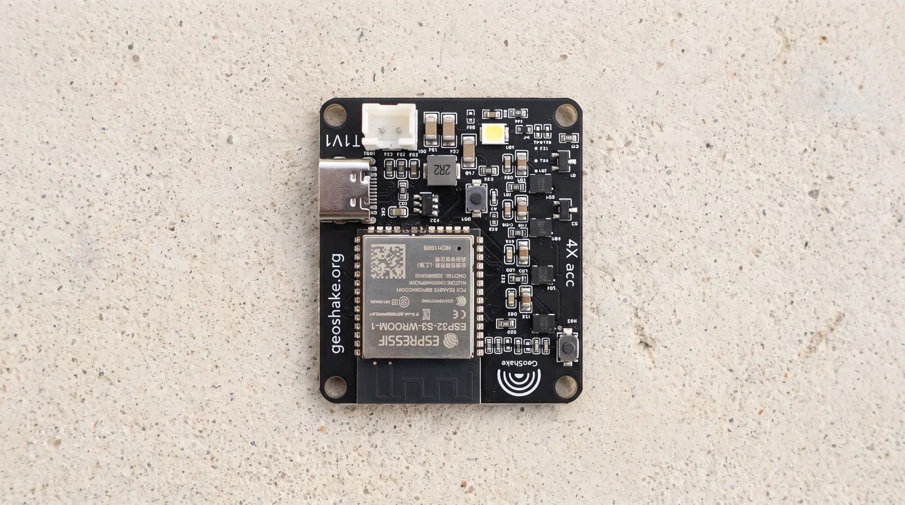
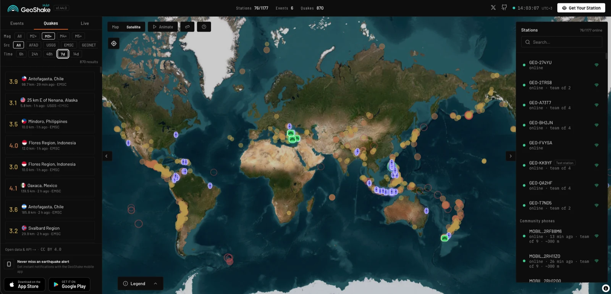
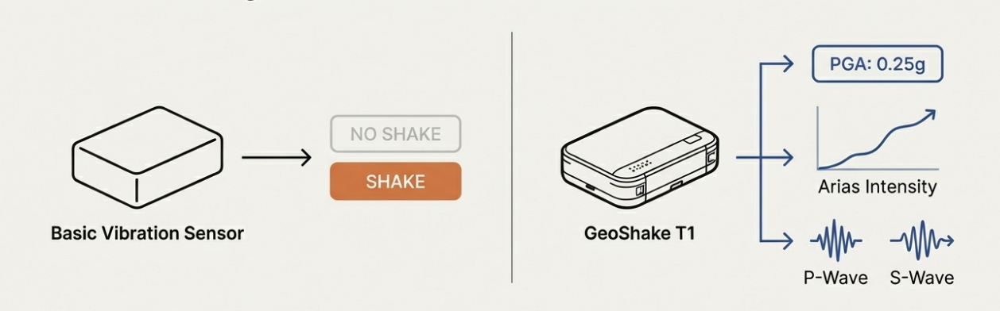
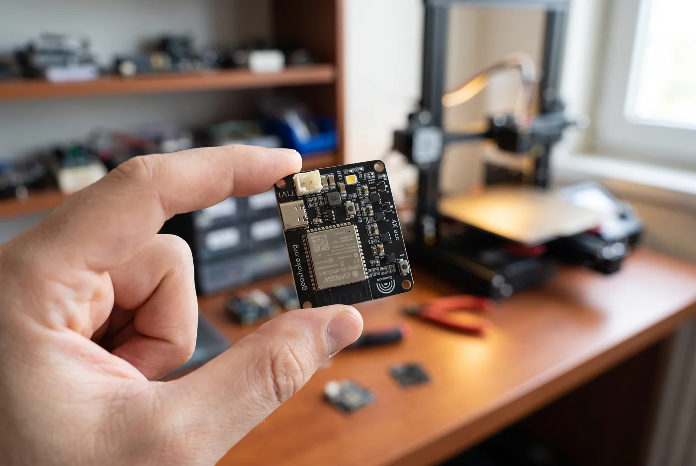
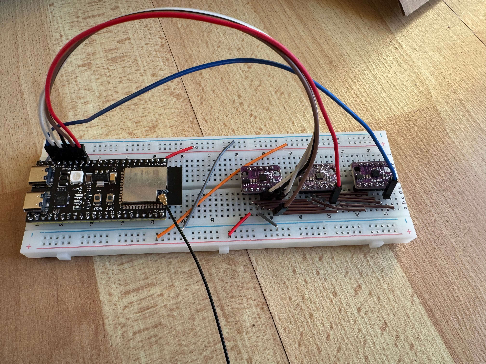

<p align="center">
  
</p>

<p align="center">
  <a href="LICENSING.md"></a>
  <a href="LICENSING.md"></a>
  <a href="https://www.fdsn.org/networks/detail/GW/"></a>
  <a href="https://doi.org/10.7914/ft1b-4x43"></a>
</p>

**Open firmware, open enclosure designs and open data for the GeoShake T1 — a
home seismic station that runs a real STA/LTA detector and publishes into a
permanently registered FDSN network.**

- 🗺️ Live station map: [map.geoshake.org](https://map.geoshake.org)
- 📊 Data access & APIs: [api.geoshake.org/developer](https://api.geoshake.org/developer)
- 🛒 Ready-made devices & mobile app: [geoshake.org](https://geoshake.org)

## Evidence

Three claims that do not depend on trusting us.

**The network is registered, not self-declared.** GeoShake operates FDSN
network code `GW` under its own DOI, with its own data centre entry. None of
those three records is issued by us:
[fdsn.org/networks/detail/GW](https://www.fdsn.org/networks/detail/GW/) ·
[10.7914/ft1b-4x43](https://doi.org/10.7914/ft1b-4x43) ·
[data centre `GEOSHAKE`](https://www.fdsn.org/datacenters/detail/GEOSHAKE/)

**The stations are real and you can list them right now.** The roster comes
out of our own FDSN service as plain text — codes, coordinates, elevations
and start times:
[`station/1/query?network=GW&level=network&format=text`](https://api.geoshake.org/fdsnws/station/1/query?network=GW&level=network&format=text).
No key, no registration. The same stations appear on
[map.geoshake.org](https://map.geoshake.org).

**The signal processing is checked against the published reference, on the
device, at every boot.** The firmware recomputes fixed golden vectors and
compares the C result with the numbers in the TypeScript reference in this
repository. The STA/LTA vector is the easiest one to check by eye — the
literals `0.00003883608158025049` and `57.60172630506509` appear both in
`golden_stalta_check` in
[`firmware/t1-revc/main/main.c`](firmware/t1-revc/main/main.c) and in
[`firmware/shared/test/stalta.test.ts`](firmware/shared/test/stalta.test.ts),
and the feature vectors in `golden_check` line up the same way with
[`firmware/shared/test/features.test.ts`](firmware/shared/test/features.test.ts).
A mismatch logs `golden ... FAIL` and drops the status light into the fast
flicker that [`docs/led-states.md`](docs/led-states.md) documents as a failed
self-check. A unit that disagrees with the reference says so instead of
quietly reporting numbers.

<p align="center">
  
</p>

## What is open, and what is not

We would rather be precise than sound impressive:

| Part | Status | License |
|---|---|---|
| Firmware (ESP-IDF, ESP32-S3) | **Open** | [GPL-3.0-or-later](firmware/LICENSE) |
| DSP reference (`shared`) | **Open** | [GPL-3.0-or-later](firmware/LICENSE) |
| Enclosure designs (STL + Fusion source) | **Open** | [CC BY-SA 4.0](hardware/enclosure/LICENSE) |
| Documentation | **Open** | [CC BY-SA 4.0](docs/LICENSE) |
| Seismic data | **Open** | [CC BY 4.0](data/LICENSE) |
| PCB design / schematics | Proprietary | not published |
| Cloud backend & network services | Proprietary | operated by us |

Because the PCB is proprietary, the device as a whole is **not** open
source hardware, and we do not describe it that way. What is open is
open for real — sources are in this repository, not just claimed in a
badge.

## The device: GeoShake T1 (Rev-C)

Most cheap "earthquake sensors" answer one question: is it shaking or not.
The T1 measures the ground motion instead, and separates the fast P-wave
that arrives first from the slower S-wave that does the damage.

<p align="center">
  
</p>

| | |
|---|---|
| MCU | ESP32-S3 (16 MB flash, 8 MB PSRAM) |
| Sensors | **4× ST LSM6DSO** accelerometers on SPI, 104 Hz, ±2 g |
| Detection | On-device STA/LTA seismic trigger + per-second RMS/PGA features |
| Waveforms | Ring-buffered event waveform — ~6 s before the trigger plus an adaptive window after it (6–24 s) — and a raw "science" capture |
| Connectivity | WiFi (2.4 GHz), MQTT over TLS |
| Setup | BLE provisioning via the GeoShake mobile app (captive-portal fallback) |
| Updates | Signed OTA (RSA-3072) with A/B rollback — **and user-reflashable over USB-C** |

<p align="center">
  
</p>

**Which build this is.** The firmware published here is `blep-0.9.27` — the
build running on customer devices today — together with the
[`sdkconfig.defaults`](firmware/t1-revc/sdkconfig.defaults) it is compiled
with. We sync this mirror by hand rather than from CI, so a newer fleet build
can land here late. If you need a specific one, ask at `info@geoshake.org`.

## Audit the science

[`firmware/shared`](firmware/shared/) is the reference implementation of the
feature maths and the STA/LTA detector, in TypeScript, with its test vectors.
The C firmware is bit-locked to it: same inputs, same numbers, re-asserted on
every boot as described under [Evidence](#evidence). Both sides are published,
so the detector can be audited without owning a device — and disagreements
surface as a failing number rather than as a difference of opinion.

**Data access.** Network code `GW`, DOI
[10.7914/ft1b-4x43](https://doi.org/10.7914/ft1b-4x43). Station metadata
(StationXML), the event catalogue (QuakeML) and live waveforms (SeedLink) are
served anonymously — no registration and no API key. Archived waveform windows
are not served over FDSN: live traces come from SeedLink, and individual
triggers download as SAC from each station page.

[**`docs/fdsn.md`**](docs/fdsn.md) is the reference for all of it — endpoints,
what each of the four channels actually contains, the counts-to-m/s² constant,
why the published response is a nominal sensitivity rather than a calibration,
worked ObsPy examples, the dates on which the meaning of archived data
changed, and how to cite the network. Read it before processing anything: two
of the channels have no known azimuth, and one of them is not a component at
all.

Network data is [CC BY 4.0](data/LICENSE). It is a community network of
uncalibrated MEMS sensors, not a warning service — `docs/fdsn.md` sets out
those limits in full.

## Build it yourself

**Start on a breadboard.** [`diy/`](diy/) is a complete build of the same
detector on about $25 of parts, in an evening, with no soldering: an ESP32-S3
dev board and one or two LSM6 accelerometer breakouts. It is not a simplified
imitation — it runs the real STA/LTA with warm-up, LTA freeze and hysteresis,
and it ships the same golden vectors so you can prove on your own hardware
that your build agrees with the network's maths. There are Arduino sketches,
a host-side test, wiring diagrams, a waveform plotter, and a variant that
serves its own live dashboard over WiFi. Start at
[`diy/README.md`](diy/README.md).

<p align="center">
  
</p>

**Or build on the T1 firmware.**

1. **Enclosure** — print the v2.1 STLs in
   [`hardware/enclosure/`](hardware/enclosure/) (ASA recommended, no
   supports, gyroid infill — 15 % lid / 99 % base and mounting base) and
   follow the assembly guide, or modify the Fusion source.
2. **Firmware** — build and flash
   [`firmware/t1-revc/`](firmware/t1-revc/) with ESP-IDF (instructions in
   its README).
3. **Network** — point the firmware at your own MQTT broker
   (`main/config.h`), or request credentials for the official network at
   [geoshake.org/join-network](https://geoshake.org/join-network).

The PCB is not published, so a full DIY build of the T1 itself means designing
your own carrier board — the firmware README documents the pinout and sensor
configuration it expects. The breadboard route above exists precisely because
that is a lot to ask.

## Repository layout

```
firmware/
  t1-revc/    ESP-IDF firmware of the shipping T1 (4x LSM6DSO)
  shared/     TypeScript DSP reference — the C firmware is bit-locked to this
  legacy/     Original DIY Arduino variants (LSM6DS3, unmaintained)
diy/          Breadboard seismometer: sketches, tests, wiring, web dashboard
hardware/
  enclosure/  STL meshes + Fusion 360 source + print/assembly docs
docs/         FDSN data access, status-light reference
data/         Seismic data licence (the data itself is served from the network)
assets/       Images (logo & wave mark are trademarks — see assets/TRADEMARK-NOTICE.md)
LICENSING.md  Which licence covers which part — authoritative
```

## Contributing

**Questions before code?** There is a Discord for people running or building
these: [discord.gg/t8CYryruPb](https://discord.gg/t8CYryruPb) — `#setup-help` for a station that will
not come online, `#build-and-print` for the enclosure and the breadboard
version, `#data-and-network` for FDSN and ObsPy. The status-light table is
pinned in the first one.

Bug fixes, firmware improvements and enclosure remixes are welcome.
Contributions require a DCO sign-off (`git commit -s`) — see
[CONTRIBUTING.md](CONTRIBUTING.md). Security issues: please read
[SECURITY.md](SECURITY.md) first, and do not open a public issue.

## 📜 License

GeoShake is **multi-licensed** — different parts of this repository carry
different licenses. The root [`LICENSE`](LICENSE) file holds the GPL-3.0
text because that is the one file GitHub reads; it does **not** cover
everything here. [**`LICENSING.md`**](LICENSING.md) is the authoritative
overview.

| Part | License | SPDX |
|---|---|---|
| Firmware & software | [GPL-3.0-or-later](firmware/LICENSE) | `GPL-3.0-or-later` |
| Enclosure designs | [CC BY-SA 4.0](hardware/enclosure/LICENSE) | `CC-BY-SA-4.0` |
| Documentation & images | [CC BY-SA 4.0](docs/LICENSE) | `CC-BY-SA-4.0` |
| Seismic data | [CC BY 4.0](data/LICENSE) | `CC-BY-4.0` |

The firmware and the enclosure designs are **share-alike**: if you
distribute modified versions you must publish your modifications under the
same license, so improvements flow back to everyone. The data is CC BY 4.0
— attribution is all it asks.

If you build products from these sources, please credit
`Source: github.com/GeoShake/geoshake`. That credit is a licence requirement
for the enclosure designs (CC BY-SA 4.0 §3). It is **not** a GPL source offer:
if you distribute a device carrying GPL firmware, §6 obliges *you* to convey
the corresponding source for the binary *you* shipped, and pointing at this
repository does not discharge that — we mirror by hand, so what is published
here is not necessarily the build in your customer's hands.

### Trademarks

"GeoShake", the logo and the wave device are trademarks of Appflows
Teknoloji A.Ş. and are **not** licensed. You may build and sell devices
based on this firmware and these enclosure designs, but not under the
GeoShake name or logo. See [TRADEMARKS.md](TRADEMARKS.md).

### Official devices & network

Pre-assembled, tested and flashed devices are sold at
[geoshake.org](https://geoshake.org). The GeoShake cloud, verification
backend and station map are operated services; joining the official
network requires credentials from
[geoshake.org/join-network](https://geoshake.org/join-network).
