<p align="center">
  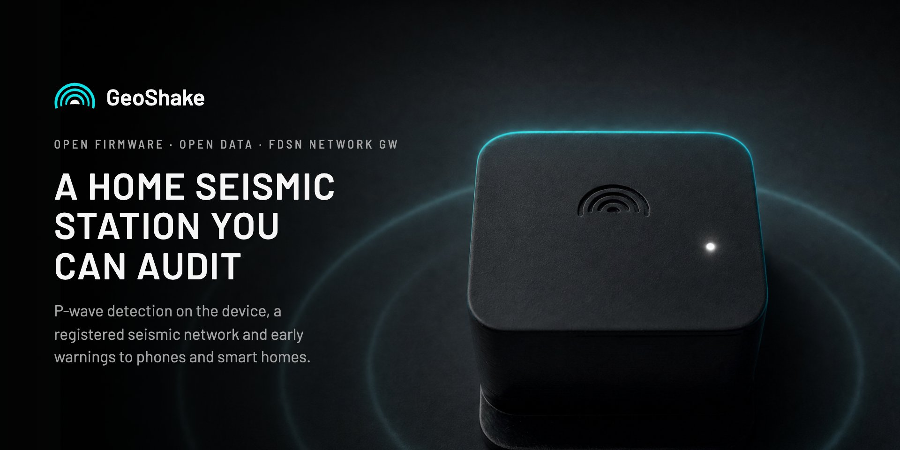
</p>

# GeoShake

**Open firmware, open enclosure designs and open data for a home seismic station.**
The GeoShake T1 detects P-waves on the device and publishes into a registered FDSN
seismic network, `GW`. When three or more stations near each other confirm an
earthquake, the network sends early warnings to the GeoShake app and to smart homes,
often seconds before the strong shaking arrives.

<p align="center">
  <a href="https://api.geoshake.org/fdsnws/station/1/query?network=GW&amp;level=station&amp;format=text"></a>
  <a href="https://www.fdsn.org/networks/detail/GW/"></a>
  <a href="https://doi.org/10.7914/ft1b-4x43"></a>
  <a href="LICENSING.md"></a>
  <a href="LICENSING.md"></a>
  <a href="data/LICENSE"></a>
  <a href="https://discord.gg/t8CYryruPb"></a>
</p>

<p align="center">
  <a href="https://map.geoshake.org"><b>Live map</b></a> ·
  <a href="#the-geoshake-app"><b>Get the app</b></a> ·
  <a href="https://api.geoshake.org/developer"><b>Data &amp; APIs</b></a> ·
  <a href="https://discord.gg/t8CYryruPb"><b>Discord</b></a> ·
  <a href="https://geoshake.org/geoshake-t1"><b>Get a T1</b></a>
</p>

## How it works

<p align="center">
  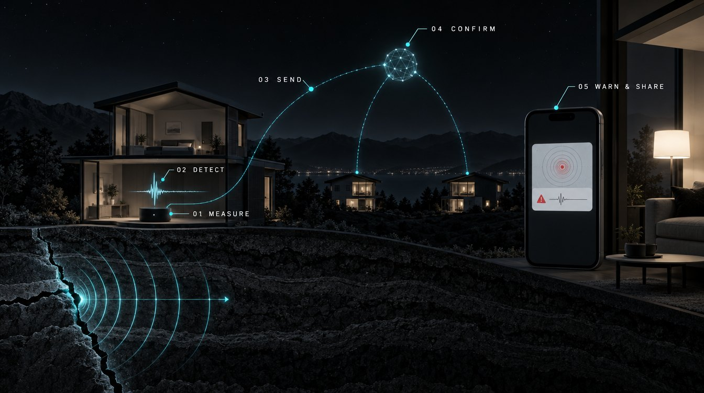
</p>

1. **Measure.** Four 6-axis sensors read the ground 104 to 110 times a second.
2. **Detect.** An STA/LTA trigger fires on the device within milliseconds.
3. **Send.** Encrypted MQTT carries the trigger and the waveform.
4. **Confirm.** Three or more nearby stations must agree. One device never alarms alone.
5. **Warn and share.** Phones and smart homes get an early warning, and the data goes out over FDSN and SeedLink.

> [!NOTE]
> Early warning is a helpful extra layer, not a guarantee. Depending on your distance
> from the epicenter it can mean about 5 to 30 seconds; close to the epicenter a warning
> can arrive after the shaking has started. GeoShake complements official warning
> systems, it does not replace them.

## The GeoShake app

<p align="center">
  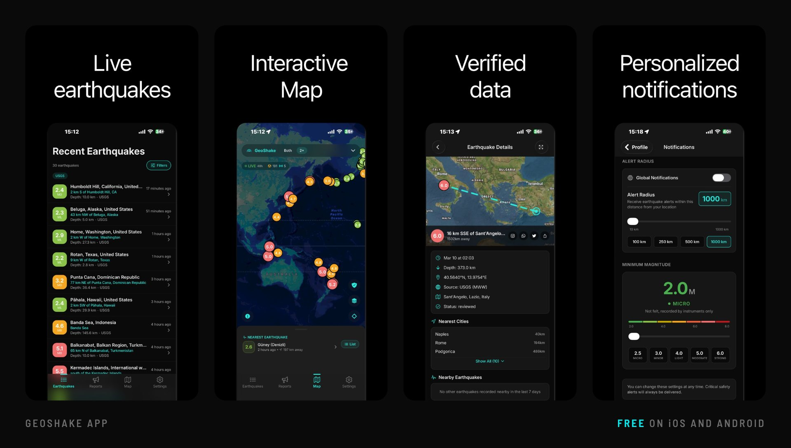
</p>

Free on iOS and Android, and the companion app for your T1.

- **Early warnings** for confirmed earthquakes, tuned to your address and alert radius.
- **A live map** of every station and every event. Open any point for its full seismogram.
- **Your own station:** live telemetry from your T1.
- **Community reports:** tell the network what you felt.

Rated 4.9 on the US App Store (332 ratings, November 2026).

<p>
  <a href="https://apps.apple.com/app/id6755887999"></a>
  <a href="https://play.google.com/store/apps/details?id=com.geoshake"></a>
</p>

## Your smart home reacts

When the network confirms an earthquake within 300 km of your station, your home can
react: lights turn on, a speaker announces it, or a scene of your choice runs.

| Platform | How it works |
|---|---|
| <br>**Google&nbsp;Home** | Certified Works with Google Home. Link your GeoShake account and an Earthquake sensor appears for your routines. No hub. |
| <br>**Amazon&nbsp;Alexa** | Enable the GeoShake skill (United States and Canada, in English) and a confirmed earthquake starts your routine. |
| <br>**Home&nbsp;Assistant** | Native integration from the Marketplace or HACS: [GeoShake/geoshake-homeassistant](https://github.com/GeoShake/geoshake-homeassistant). |
| 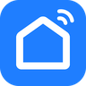<br>**Smart&nbsp;Life&nbsp;&amp;&nbsp;Tuya** | In Central Europe: scan one code and the T1 appears, ready for Tap-to-Run scenes. |

Setup guides: [geoshake.org/integrations](https://geoshake.org/integrations).
Smart-home automations are an extra notification layer, not a life-safety system.

## Why you can check it

- **The network is registered, not self-declared.** FDSN network code `GW`, its DOI and
  the `GEOSHAKE` data centre entry are issued by others, not by us:
  [fdsn.org/networks/detail/GW](https://www.fdsn.org/networks/detail/GW/) ·
  [10.7914/ft1b-4x43](https://doi.org/10.7914/ft1b-4x43) ·
  [data centre `GEOSHAKE`](https://www.fdsn.org/datacenters/detail/GEOSHAKE/)
- **The stations are real, and you can list them now.** Our FDSN service returns the
  roster as plain text, with no key and no registration:
  [station list](https://api.geoshake.org/fdsnws/station/1/query?network=GW&level=station&format=text).
  The stations badge above counts them live from the same service, and the same
  stations appear on [map.geoshake.org](https://map.geoshake.org).
- **The detector checks itself at every boot.** The C firmware recomputes golden vectors
  and compares them with the TypeScript reference in this repository. The literals
  `0.00003883608158025049` and `57.60172630506509` appear both in `golden_stalta_check`
  in [`firmware/t1-revc/main/main.c`](firmware/t1-revc/main/main.c) and in
  [`firmware/shared/test/stalta.test.ts`](firmware/shared/test/stalta.test.ts), and the
  feature vectors in `golden_check` line up the same way with
  [`features.test.ts`](firmware/shared/test/features.test.ts). A mismatch logs
  `golden ... FAIL` and switches the status light to the fast flicker that
  [`docs/led-states.md`](docs/led-states.md) documents as a failed self-check.

## What's open, and what isn't

<p align="center">
  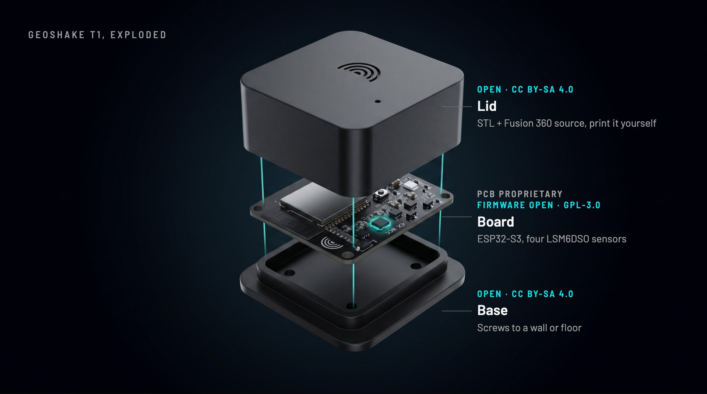
</p>

| Part | Status | License |
|---|---|---|
| Firmware (ESP-IDF, ESP32-S3) | **Open** | [GPL-3.0-or-later](firmware/LICENSE) |
| DSP reference (`shared`) | **Open** | [GPL-3.0-or-later](firmware/LICENSE) |
| Enclosure designs (STL + Fusion source) | **Open** | [CC BY-SA 4.0](hardware/enclosure/LICENSE) |
| Documentation | **Open** | [CC BY-SA 4.0](docs/LICENSE) |
| Seismic data | **Open** | [CC BY 4.0](data/LICENSE) |
| PCB design and schematics | Proprietary | not published |
| Cloud backend and network services | Proprietary | operated by us |

Because the PCB is proprietary, the device as a whole is **not** open source hardware,
and we don't describe it that way. What is open is open for real: the sources are in this
repository, not just claimed in a badge.

## The T1

<p align="center">
  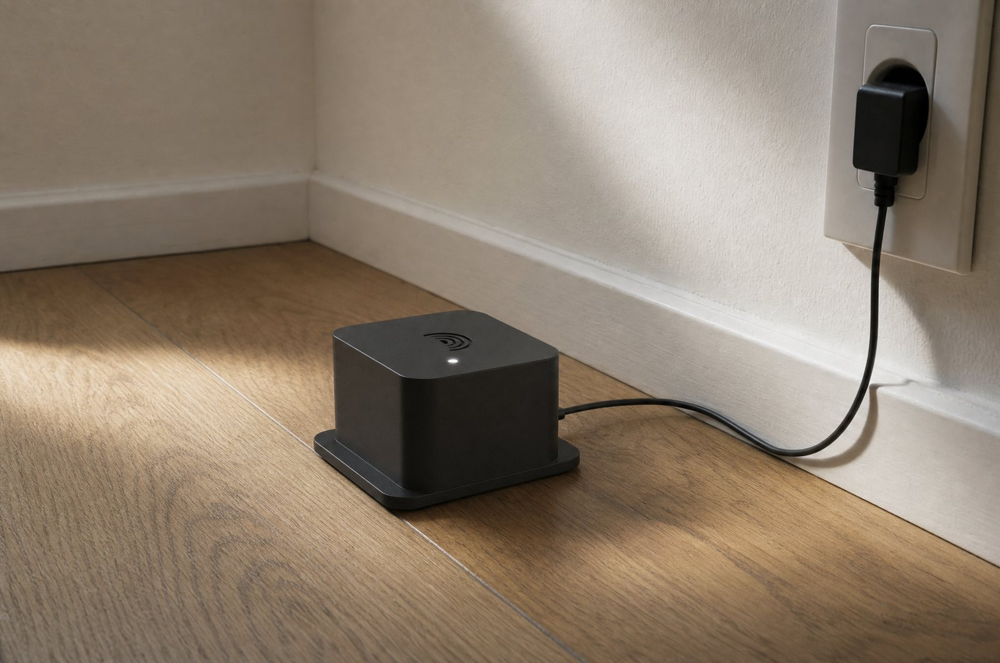
</p>

Most cheap "earthquake sensors" answer one question: is it shaking or not. The T1
measures the ground motion itself, and separates the fast P-wave that arrives first from
the slower S-wave that does the damage.

Plug it into USB power and set it up from the GeoShake app over Bluetooth (or, as a
fallback, join its `GeoShake-XXXX` Wi-Fi from your phone); most people are live in about
two minutes. It needs a power outlet and 2.4 GHz Wi-Fi (5 GHz-only networks are not
supported). Mount it on a fixed, rigid surface; a load-bearing column or beam is ideal.

| | |
|---|---|
| **Sensing** | 4 × 6-axis IMUs (ST LSM6DSO) on SPI, 104 to 110 Hz on all axes, 16-bit, ±2 g. Noise floor about 35 µg/√Hz across the four-sensor array (datasheet-derived). |
| **Compute** | ESP32-S3, dual-core 240 MHz, 8 MB PSRAM, 16 MB flash |
| **Detection** | On-device STA/LTA (0.5 s / 30 s windows) and per-second RMS/PGA features |
| **Waveforms** | About 6 s before the trigger plus an adaptive 6 to 24 s after it. **Science Mode** records the full raw waveform, three axes at about 110 Hz. |
| **Connectivity** | Wi-Fi 2.4 GHz (802.11 b/g/n), Bluetooth LE 5, MQTT over TLS, SNTP time sync (about 10 ms) |
| **Updates** | Signed OTA (RSA-3072) with automatic rollback, and reflashable over USB-C |
| **Power** | USB-C, 0.7 to 1 W typical. Adapter 5 V / 1 A minimum, not included. |
| **Body** | 64 × 54 × 34 mm, 45 g, operating -40 °C to +60 °C |
| **Privacy** | Only acceleration data leaves the device. No camera, no microphone. |
| **In the box** | T1 (assembled, tested, flashed), 1 m USB-C cable (power only), Station Passport, mounting kit (clamp plate, 2 plugs, 2 screws) |

**Which firmware this is.** This repository carries `blep-0.9.27`, with the
[`sdkconfig.defaults`](firmware/t1-revc/sdkconfig.defaults) it is built with. The fleet
runs newer builds and we sync this mirror by hand rather than from CI, so it can lag
behind. If you need a specific build, ask at `info@geoshake.org`.

## Audit the science

[`firmware/shared`](firmware/shared/) is the reference implementation of the feature
maths and the STA/LTA detector, in TypeScript, with its test vectors. The C firmware is
bit-locked to it: same inputs, same numbers, checked on every boot. Both sides are
published, so you can audit the detector without owning a device, and a disagreement
shows up as a failing number rather than as a difference of opinion.

## Use the data

Station metadata (StationXML), the event catalogue (QuakeML) and live waveforms
(SeedLink) are open, with no registration and no API key. Archived waveform windows are
not served over FDSN: live traces come from SeedLink, and individual triggers download as
SAC from each station page.

```python
from obspy.clients.fdsn import Client

client = Client(base_url="https://api.geoshake.org")
inv = client.get_stations(network="GW", level="station")
print(inv)
```

[**`docs/fdsn.md`**](docs/fdsn.md) covers the rest: endpoints, what each of the four
channels contains, the counts-to-m/s² constant, worked ObsPy examples and how to cite the
network. The sensors are uncalibrated MEMS accelerometers and two of the channels have no
known azimuth, so read it before processing anything. Network data is
[CC BY 4.0](data/LICENSE).

**GeoShake Scope** is a free desktop app for deep analysis of the earthquakes the network
captures: waveforms, spectrograms and P/S phase picking, on Windows, macOS and Linux.
[Download](https://geoshake.org/scope) · [GeoShake/scope](https://github.com/GeoShake/scope)

| Waveforms | Spectrogram | P/S picking |
|---|---|---|
| 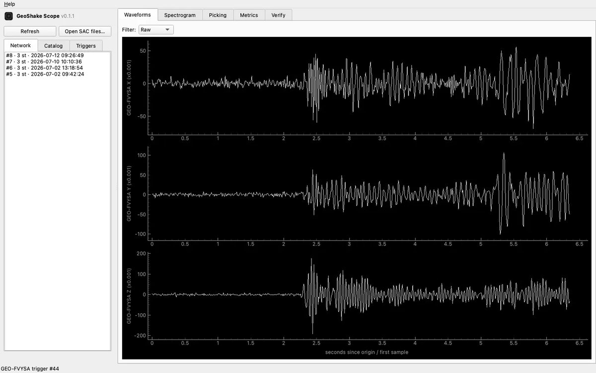 | 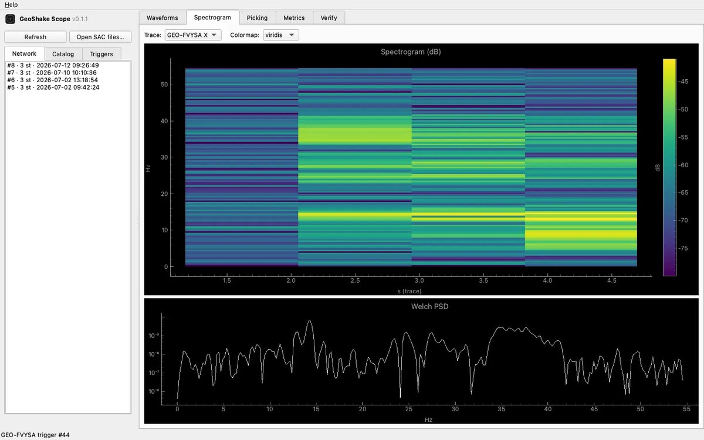 | 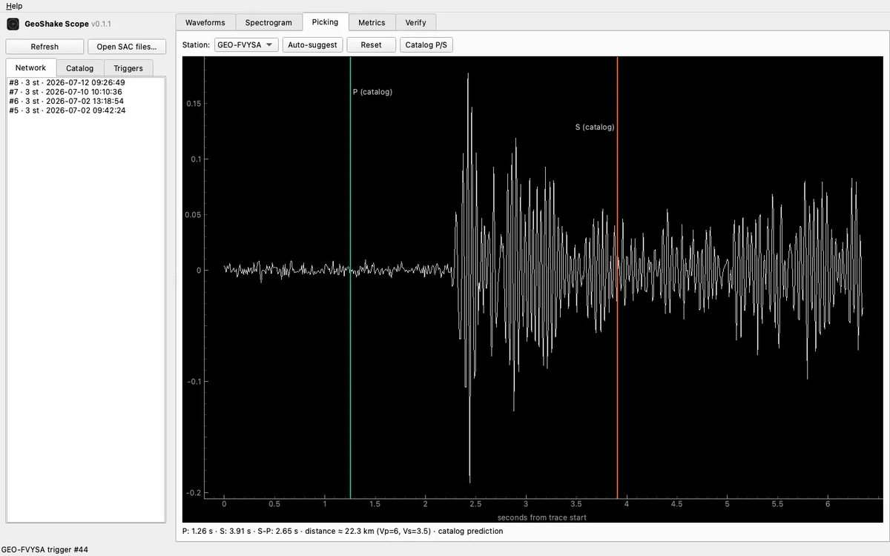 |

## Join the network

<table>
  <tr>
    <th width="33%">GeoShake T1</th>
    <th width="33%">Maker Edition</th>
    <th width="33%">Sponsor a region</th>
  </tr>
  <tr>
    <td valign="top">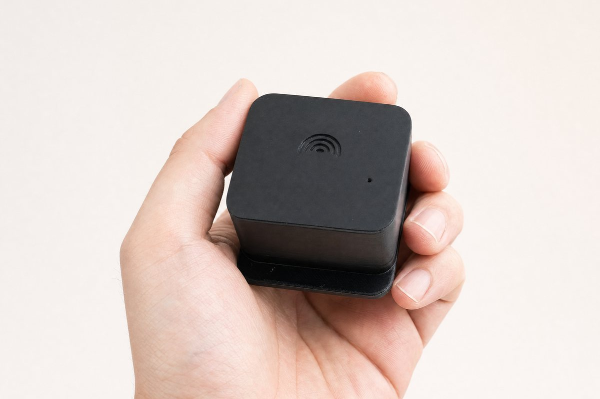<br>Assembled, tested and flashed. Plug it in and you are contributing in about two minutes.<br><a href="https://geoshake.org/geoshake-t1">geoshake.org/geoshake-t1</a></td>
    <td valign="top">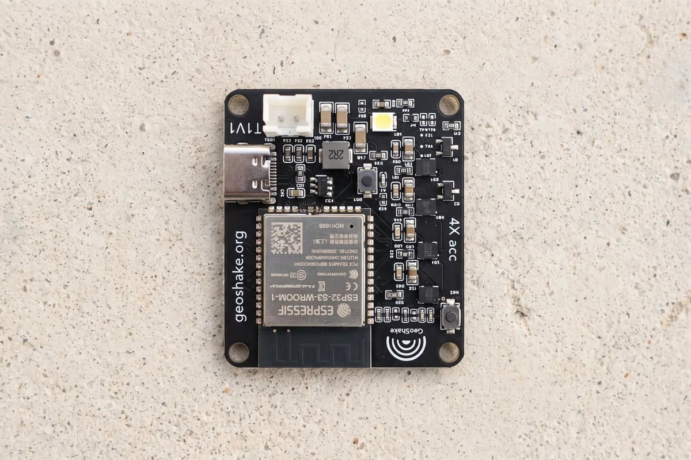<br>The same electronics as the T1, assembled, tested, firmware already on it. You print the enclosure.<br><a href="https://geoshake.org/board">geoshake.org/board</a></td>
    <td valign="top">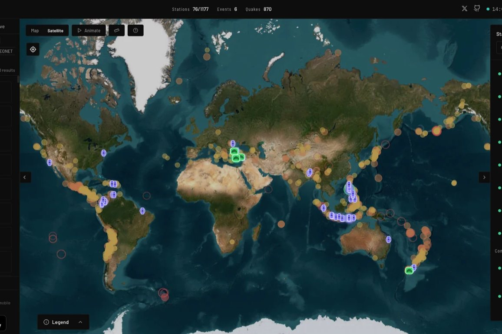<br>Donate a batch of 12 or more stations to a school, a municipality or a high-risk region selected by local scientists.<br><a href="https://geoshake.org/sponsor-a-region">geoshake.org/sponsor-a-region</a></td>
  </tr>
</table>

**How many stations does an area need?** The network publishes an earthquake only when at
least three stations near each other agree; below three, the shaking is recorded but no
event is located. See where coverage is missing with the
[coverage planner](https://geoshake.org/coverage).

## Build your own

<table>
  <tr>
    <th width="50%">On a breadboard, about $25</th>
    <th width="50%">On the T1 firmware</th>
  </tr>
  <tr>
    <td valign="top">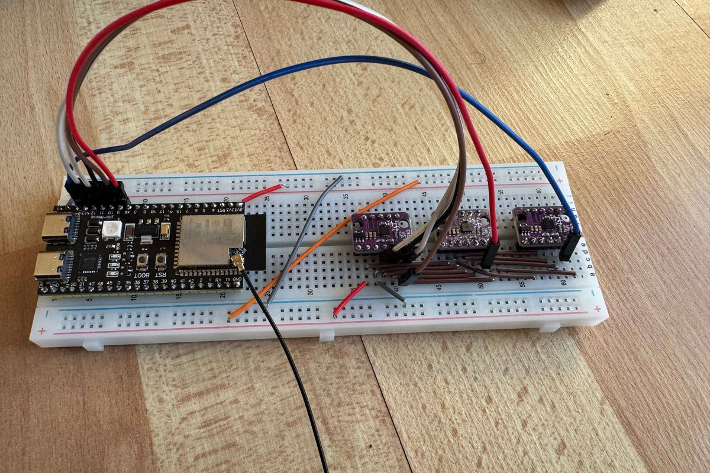<br>An ESP32-S3 dev board and one or two LSM6 breakouts, one evening, no soldering. It runs the real STA/LTA with warm-up, LTA freeze and hysteresis, and ships the same golden vectors, so you can prove your build agrees with the network's maths. Start at <a href="diy/README.md"><code>diy/README.md</code></a>.</td>
    <td valign="top">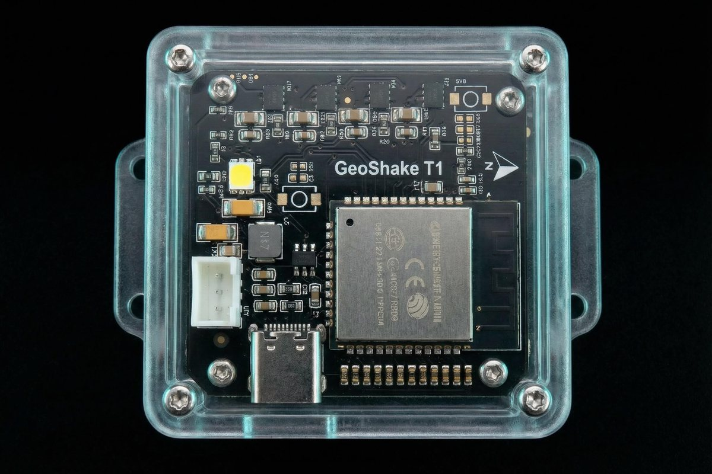<br>1. Print the v2.1 enclosure from <a href="hardware/enclosure/"><code>hardware/enclosure</code></a> (ASA recommended, no supports) and follow its assembly guide.<br>2. Build and flash <a href="firmware/t1-revc/"><code>firmware/t1-revc</code></a> with ESP-IDF.<br>3. Point it at your own MQTT broker (<code>main/config.h</code>), or request credentials for the official network at <a href="https://geoshake.org/join-network">geoshake.org/join-network</a>.</td>
  </tr>
</table>

The PCB is not published, so a full DIY build of the T1 itself means designing your own
carrier board; the firmware README documents the pinout and sensor configuration it
expects. The breadboard route exists because that is a lot to ask.

## Related repositories

- [**GeoShake/scope**](https://github.com/GeoShake/scope): desktop app for deep analysis of earthquakes captured by the network
- [**GeoShake/geoshake-homeassistant**](https://github.com/GeoShake/geoshake-homeassistant): earthquake early warning for Home Assistant

<details>
<summary><b>Repository layout</b></summary>

```
firmware/
  t1-revc/    ESP-IDF firmware of the shipping T1 (4x LSM6DSO)
  shared/     TypeScript DSP reference, the C firmware is bit-locked to it
  legacy/     Original DIY Arduino variants (LSM6DS3, unmaintained)
diy/          Breadboard seismometer: sketches, tests, wiring, web dashboard
hardware/
  enclosure/  STL meshes, Fusion 360 source, print and assembly guide
docs/         FDSN data access, status-light reference
data/         Seismic data licence (the data is served from the network)
assets/       Images (GeoShake and third-party marks are excluded from the licences,
              see assets/TRADEMARK-NOTICE.md)
LICENSING.md  Which licence covers which part, authoritative
```

</details>

## Contribute

**Questions first?** Join the [Discord](https://discord.gg/t8CYryruPb): `#setup-help` for a
station that won't come online (the status-light table is pinned there), `#build-and-print`
for the enclosure and the breadboard build, `#data-and-network` for FDSN and ObsPy.

Bug fixes, firmware improvements and enclosure remixes are welcome. Every commit needs a
DCO sign-off (`git commit -s`), see [CONTRIBUTING.md](CONTRIBUTING.md). Security issues:
read [SECURITY.md](SECURITY.md) first and don't open a public issue.

## License

GeoShake is **multi-licensed**: different parts of this repository carry different
licenses. The root [`LICENSE`](LICENSE) file holds the GPL-3.0 text because that is the
one file GitHub reads; it does **not** cover everything here.
[**`LICENSING.md`**](LICENSING.md) is the authoritative overview.

| Part | License | SPDX |
|---|---|---|
| Firmware and software | [GPL-3.0-or-later](firmware/LICENSE) | `GPL-3.0-or-later` |
| Enclosure designs | [CC BY-SA 4.0](hardware/enclosure/LICENSE) | `CC-BY-SA-4.0` |
| Documentation and images | [CC BY-SA 4.0](docs/LICENSE) | `CC-BY-SA-4.0` |
| Seismic data | [CC BY 4.0](data/LICENSE) | `CC-BY-4.0` |

The firmware and the enclosure designs are **share-alike**: if you distribute modified
versions you must publish your modifications under the same license, so improvements flow
back to everyone. The data is CC BY 4.0; attribution is all it asks.

### Trademarks

"GeoShake", the logo and the wave device are trademarks of Appflows Teknoloji A.Ş. and
are **not** licensed. You may build and sell devices based on this firmware and these
enclosure designs, but not under the GeoShake name or logo. See
[TRADEMARKS.md](TRADEMARKS.md). The App Store, Google Play, Google Home, Amazon Alexa,
Home Assistant and Smart Life logos in `assets/images/third-party/` belong to their
owners and are not covered by this repository's licenses.

### Official devices and network

Pre-assembled, tested and flashed devices are sold at [geoshake.org](https://geoshake.org).
The GeoShake cloud, verification backend and station map are operated services; joining
the official network requires credentials from
[geoshake.org/join-network](https://geoshake.org/join-network).

<details>
<summary><b>Shipping devices with this firmware</b></summary>

If you build products from these sources, please credit
`Source: github.com/GeoShake/geoshake`. That credit is a licence requirement for the
enclosure designs (CC BY-SA 4.0 §3). It is **not** a GPL source offer: if you distribute a
device carrying GPL firmware, §6 obliges *you* to convey the corresponding source for the
binary *you* shipped. Pointing at this repository does not discharge that, because we
mirror by hand and what is published here is not necessarily the build in your
customer's hands.

</details>
