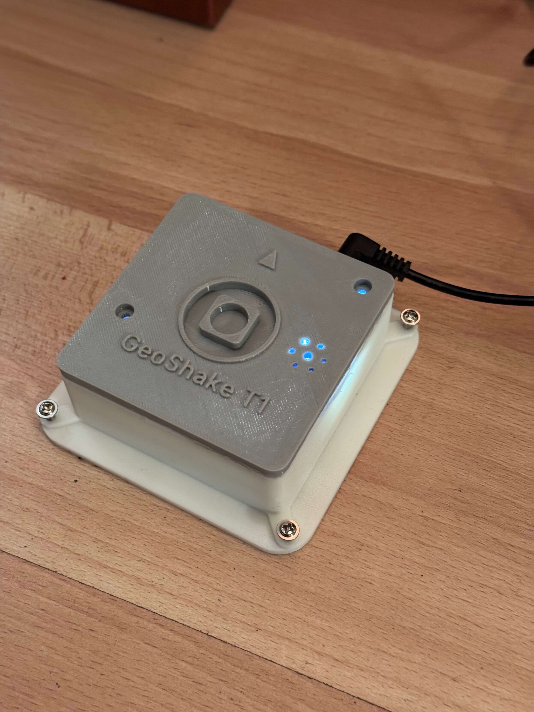
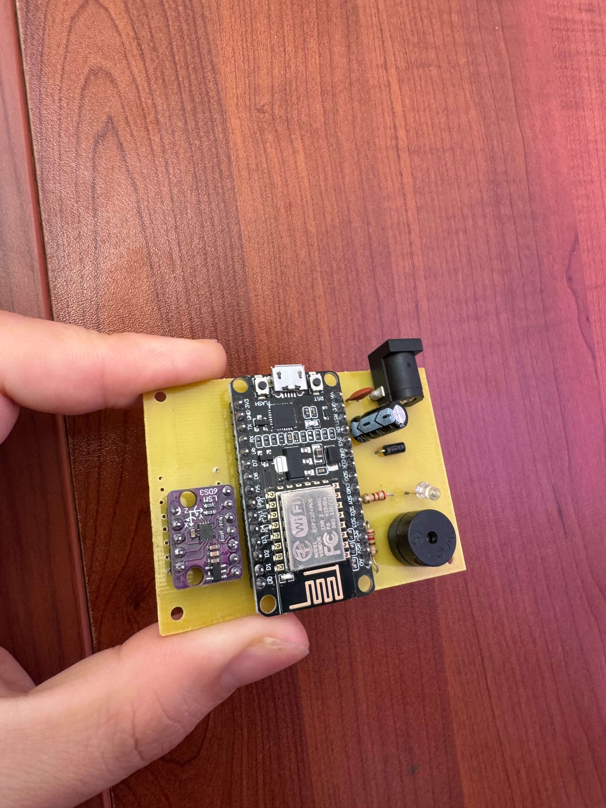
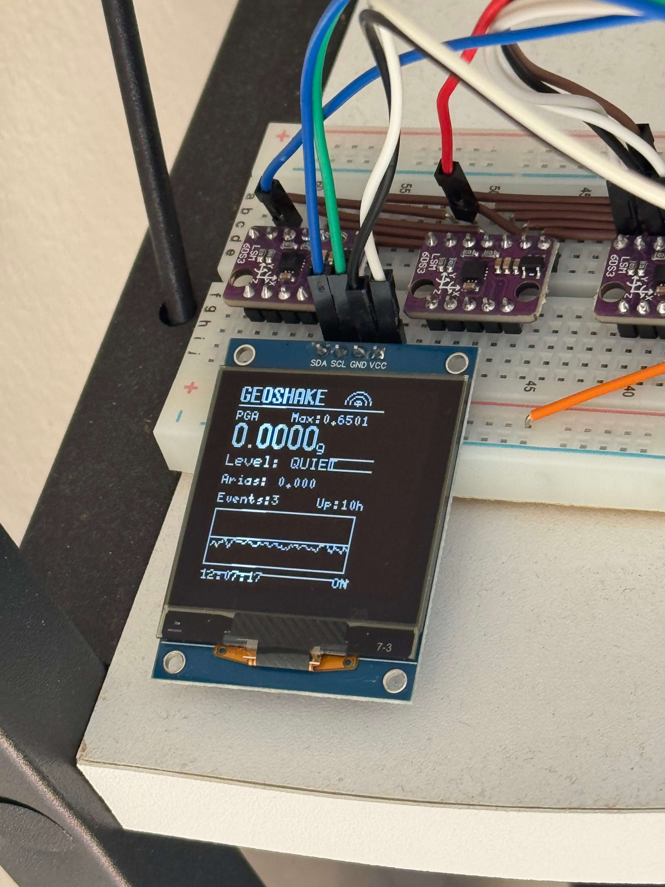
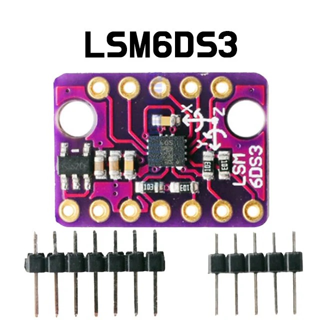
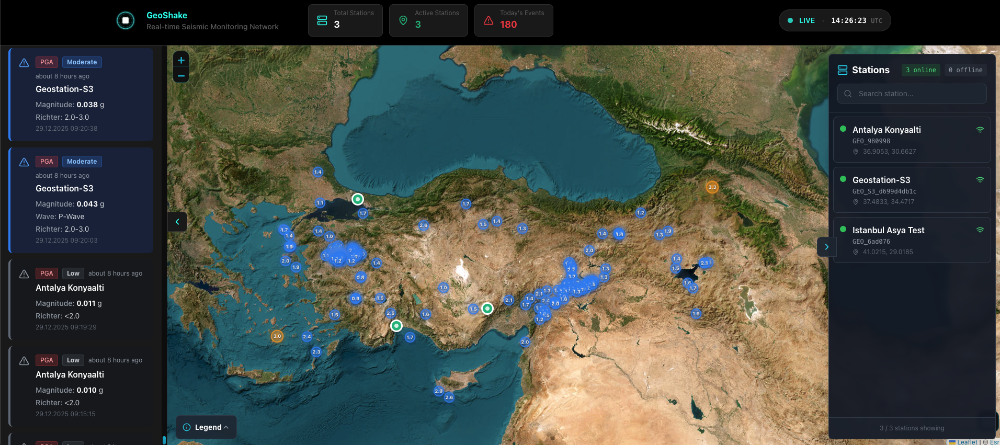

<p align="center">
  
  
  
  
</p>

# 🌍 GeoShake

**A DIY, Open-Source IoT Seismic Monitoring Station**

> _Think of GeoShake as a trained guard dog listening to the Earth's depths. It won't react to ordinary noise (like a passing truck), but when it senses real danger (P and S waves), it doesn't just bark (raise an alarm)—it records how big the threat is and delivers the full report once the connection is restored._

<p align="center">
  
</p>

### 📷 Hardware Gallery

<p align="center">
  
  
  
</p>
<p align="center">
  
  
  
</p>

### 🗺️ Live Stations Map Preview

<p align="center">
  
</p>

---

## 🚀 What Is This?

GeoShake is a **distributed, real-time earthquake monitoring station** you can build yourself! It's designed to be placed in homes, offices, or anywhere you want to contribute to a global seismic monitoring network.

Unlike simple vibration sensors, GeoShake computes **professional seismological metrics**:

| Metric | What It Measures |
|--------|-----------------|
| **PGA** (Peak Ground Acceleration) | Maximum instantaneous ground acceleration with Richter-scale estimation |
| **Arias Intensity** | Cumulative energy and destructive potential of shaking |
| **P-Wave Detection** | Early-arriving vertical compression waves |
| **S-Wave Detection** | Secondary, more damaging horizontal shear waves |

---

## ✨ Features

- 🎯 **Real-time MQTT Telemetry** — Publishes to HiveMQ Cloud for network-wide monitoring
- 📱 **Mobile WiFi Provisioning** — No coding required! Connect via "GeoLink-216" hotspot
- 🧠 **STA/LTA Signal Processing** — Industry-standard seismic event detection algorithm
- 🔌 **Dual-Sensor Noise Reduction** — 2x LSM6DS3/LSM6DSOX sensors averaged for cleaner signals
- 📡 **Offline Buffering** — Ring buffer stores data during connectivity loss
- 🌐 **Local Web Dashboard** — View live data at your device's IP
- 💡 **LED Status Indicators** — Visual feedback for connection, events, and monitoring
- 🔊 **Audible Alerts** — Buzzer activation on seismic events
- ⚡ **OTA Updates** — Remote firmware updates supported
- 🔧 **Auto-Calibration** — 1000-sample gravity baseline calibration stored in EEPROM

---

## 🛠️ Hardware

### Components Needed

| Component | Quantity | Notes |
|-----------|----------|-------|
| ESP32-S3-WROOM | 1 | Recommended for dual-sensor SPI setup |
| ESP8266 NodeMCU v3 | 1 | Alternative: dual-sensor SPI setup |
| LSM6DS3 / LSM6DSOX | 2 (min 2 recommended) |
| LED (any color) | 1 | Status indicator |
| Buzzer | 1 | Optional, for audible alerts |
| Resistors, wires, etc. | — | Standard prototyping supplies |

### Pin Configuration (ESP32-S3)

```
┌─────────────────────────────────────┐
│           ESP32-S3 WROOM            │
├─────────────────────────────────────┤
│  SPI Bus:                           │
│    SCK  → GPIO 12                   │
│    MISO → GPIO 13                   │
│    MOSI → GPIO 11                   │
│                                     │
│  Sensor 1 (CS) → GPIO 9             │
│  Sensor 2 (CS) → GPIO 10            │
│                                     │
│  LED    → GPIO 48                   │
│  Buzzer → GPIO 5                    │
└─────────────────────────────────────┘
```

### Pin Configuration (ESP8266 NodeMCU — I2C)

```
┌─────────────────────────────────────┐
│         ESP8266 NodeMCU v3          │
├─────────────────────────────────────┤
│  I2C Bus:                           │
│    SDA → GPIO 4  (D2)               │
│    SCL → GPIO 5  (D1)               │
│                                     │
│  Sensor Address: 0x6B (or 0x6A)     │
│                                     │
│  LED    → GPIO 12 (D6)              │
│  Buzzer → GPIO 14 (D5)              │
└─────────────────────────────────────┘
```

> 💡 **Tip**: The ESP8266 I2C variant uses a single LSM6DS3 sensor. If the sensor isn't detected at `0x6B`, try `0x6A` (jumper setting on some breakout boards).

### Coordinate System (ENU Standard)

The firmware follows seismological ENU convention:

```
       Up (Z+) ↑
               │
               │    
      North    │    East
      (Y+)  ───┼───→ (X+)
```

- **E (East)**: Sensor X-axis
- **N (North)**: Sensor Y-axis  
- **U (Up)**: Sensor Z-axis (gravity = ~1.0g when level)

---

## 📂 Repository Structure

```
geoShakeGithub/
├── firmware/
│   ├── ESP32_LSM6DS3_SPI_2XSENSOR/    # ⭐ Primary ESP32-S3 firmware
│   │   ├── esp32_lsm6ds3_spi_2xsensor.ino
│   │   └── SeismicDiscriminator.h      # STA/LTA wave detection
│   ├── ESP8266_LSM6DS3_I2C_XSENSOR/    # ESP8266 I2C variant
│   └── ESP8266_LSM6DS3_SPI_2XSENSOR/   # ESP8266 SPI variant
├── hardware/
│   ├── pcb/                            # PCB design files
│   ├── schematics/                     # Circuit schematics
│   └── 3dprint/                        # Enclosure STL files
└── README.md
```

---

## ⚡ Quick Start

### 1. Flash the Firmware

1. Open `firmware/ESP32_LSM6DS3_SPI_2XSENSOR/` in Arduino IDE or PlatformIO
2. Install required libraries:
   - `ArduinoJson`
   - `PubSubClient`
3. Update MQTT credentials in the sketch:
   ```cpp
   const char *mqtt_username = "YOUR_USERNAME";
   const char *mqtt_password = "YOUR_PASSWORD";
   ```
   👉 Get credentials at: [geoshake.org/join-network.html](https://www.geoshake.org/join-network.html)

4. Upload to your ESP32-S3

### 2. WiFi Provisioning

On first boot (or if WiFi fails):

1. 📡 Device creates **"GeoLink-216"** hotspot
2. 📱 Connect your phone to this network  
3. 🌐 Open **http://192.168.4.1** in browser
4. 🔐 Enter your home WiFi credentials
5. ✅ Device reboots and connects to your network

### 3. Verify Connection

Watch the serial monitor for:
```
[OK] WiFi connected!
IP: 192.168.x.x
[OK] MQTT connected to HiveMQ Cloud
[OK] Calibration loaded from EEPROM
```

---

## 📊 MQTT Topic Structure

```
seismic/stations/{station_id}/
├── status        # Periodic heartbeat (every 30s)
├── telemetry     # Real-time sensor data
├── events/
│   ├── pga       # PGA threshold events
│   └── arias     # Arias intensity events
├── commands      # Remote control (subscribed)
└── lwt           # Last Will & Testament
```

### Telemetry Payload Example

```json
{
  "station_id": "GEO_S3_a1b2c3d4",
  "timestamp": "2025-01-15T14:30:00Z",
  "pga": 0.0042,
  "arias_intensity": 0.0018,
  "axis": {
    "east": 0.0012,
    "north": -0.0008,
    "up": 0.0035
  },
  "wave_type": "P-Wave",
  "richter_estimate": "<2.0",
  "rssi": -65
}
```

---

## 🧪 How It Works

### PGA Detection Logic

```
PGA = sqrt(E² + N² + U²)

Thresholds:
├── LOW:     0.008g → Minor vibration
├── MEDIUM:  0.015g → Noticeable shaking
├── HIGH:    0.030g → Significant event
└── SEVERE:  0.080g → Major earthquake
```

### STA/LTA Wave Discrimination

The firmware uses a **Recursive Short-Term Average / Long-Term Average** algorithm:

```
STA_new = (sample × 0.1) + (STA_old × 0.9)   // ~0.5s window
LTA_new = (sample × 0.01) + (LTA_old × 0.99) // ~10s window

P-Wave Trigger: (STA_z / LTA_z) > 2.5  // Vertical energy spike
S-Wave Arrival: Horizontal > Vertical × 1.2
```

### Arias Intensity

```
Ia = (π / 2g) × ∫ a²(t) dt
```

Calculated using a circular buffer of 200 samples with running sum optimization.

---

## 🌐 Join the Network

GeoShake stations form a **distributed seismic intelligence network**. The more nodes, the better the coverage!

**Options:**
1. 🛒 **Buy a ready-made device** — Plug & play, pre-configured
2. 🔧 **Build your own** — Flash firmware, join with your MQTT credentials

�️ **[View Live Station Map](https://stations.geoshake.org)** — See all active stations in real-time!

�👉 **[Get Started at geoshake.org](https://www.geoshake.org)**

---

## 📜 License & Legal Notice

### Open-Source Software

The **source code** (firmware, software, documentation) in this repository is **open source**.

You are free to:
- Copy, modify, and distribute the code
- Build your own GeoShake device using these designs
- Create derivative works and improvements
- Use the code for personal, educational, or commercial DIY projects

### Hardware & Pre-Built Devices

> [!CAUTION]
> **GeoShake** is the **sole authorized manufacturer** of pre-assembled GeoShake devices.

The open-source nature of this project applies to the published source materials only. Pre-built devices sold through official channels are proprietary products protected by applicable intellectual property laws.

---

## 🤝 Contributing

Pull requests welcome! Some ideas:
- Development of a better algorithms for seismic analysis
- Additional sensor support (ADXL345, MPU6050)
- Machine learning event classification
- Integration with USGS/EMSC APIs
- Mobile companion app improvements

---

## 📞 Support

- 🐛 **Issues**: Open a GitHub issue
- 💬 **Community**: [stt.gg/RTrkfwBN](https://stt.gg/RTrkfwBN)
- 📞 **Contact**: [geoshake.org/contact.html](https://www.geoshake.org/contact.html) 

---

<p align="center">
  <strong>🌍 Built by makers, for the planet. 🌍</strong>
  <br><br>
  <em>Every node counts. Together, we feel the Earth.</em>
</p>
