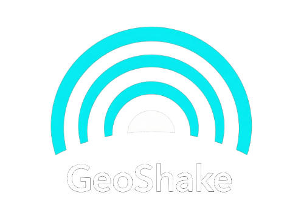

<p align="center">
  
</p>

<p align="center">
  
  
  
  
  
</p>

**Open source firmware, open enclosure designs and open data for a
real-time earthquake monitoring station.**

GeoShake is a distributed, real-time earthquake monitoring station. Devices
are placed in homes, offices and schools and contribute to a global seismic
network with a mobile app, live station map and earthquake notifications.

- 🛒 Ready-made devices & mobile app: [geoshake.org](https://geoshake.org)
- 🗺️ Live station map: [stations.geoshake.org](https://stations.geoshake.org) (legacy — new version in progress)
- 📊 Seismic data & APIs: [api.geoshake.org/developer](https://api.geoshake.org/developer)

## What is open, and what is not

We would rather be precise than sound impressive:

| Part | Status | License |
|---|---|---|
| Firmware (ESP-IDF, ESP32-S3) | **Open** | [GPL-3.0-or-later](firmware/LICENSE) |
| DSP reference (`shared`) | **Open** | [GPL-3.0-or-later](firmware/LICENSE) |
| Enclosure designs (STL + Fusion source) | **Open** | [CC BY-SA 4.0](hardware/enclosure/LICENSE) |
| Documentation | **Open** | [CC BY-SA 4.0](docs/LICENSE) |
| Seismic data | **Open** | [CC BY 4.0](data/LICENSE) |
| PCB design / schematics | Proprietary | not published |
| Cloud backend & network services | Proprietary | operated by us |

Because the PCB is proprietary, the device as a whole is **not** open
source hardware, and we do not describe it that way. What is open is
open for real — sources are in this repository, not just claimed in a
badge.

## GeoShake T1 (Rev-C) — the shipping device

| | |
|---|---|
| MCU | ESP32-S3 (16 MB flash) |
| Sensors | **4× ST LSM6DSO** accelerometers on SPI, 104 Hz, ±2 g |
| Detection | On-device STA/LTA seismic trigger + per-second RMS/PGA features |
| Waveforms | Ring-buffered event waveform (~6.5 s around each trigger) + raw "science" capture |
| Connectivity | WiFi (2.4 GHz), MQTT over TLS |
| Setup | BLE provisioning via the GeoShake mobile app (captive-portal fallback) |
| Updates | Signed OTA (RSA-3072) with A/B rollback — **and user-reflashable over USB-C** |

## Repository layout

```
firmware/
  t1-revc/    ESP-IDF firmware of the shipping T1 (4× LSM6DSO)
  shared/     TypeScript DSP reference — the C firmware is bit-locked to this
  legacy/     Original DIY Arduino variants (LSM6DS3, unmaintained)
hardware/
  enclosure/  STL meshes + Fusion 360 source + print/assembly docs
data/         Seismic data licence (the data itself is served from the network)
docs/         Documentation
assets/       Images (logo & wave mark are trademarks — see assets/TRADEMARK-NOTICE.md)
```

## Verifiable science

The feature math and the STA/LTA detector in the C firmware are
**bit-locked** to the TypeScript reference in
[`firmware/shared`](firmware/shared/). Golden vectors are re-asserted on
every boot — if the C and TS results diverge, the boot log prints `FAIL`.
Both sides are published here so the signal processing can be audited
independently.

## Build it yourself

1. **Enclosure** — print the STLs in
   [`hardware/enclosure/`](hardware/enclosure/) (PETG or ASA, 25 % infill,
   no supports) and follow the assembly guide, or modify the Fusion source.
2. **Firmware** — build and flash
   [`firmware/t1-revc/`](firmware/t1-revc/) with ESP-IDF (instructions in
   its README).
3. **Network** — point the firmware at your own MQTT broker
   (`main/config.h`), or request credentials for the official network at
   [geoshake.org/join-network](https://geoshake.org/join-network).

The PCB is not published, so a full DIY build means designing your own
carrier board — the firmware README documents the pinout and sensor
configuration it expects.

## Contributing

Bug fixes, firmware improvements and enclosure remixes are welcome.
Contributions require a DCO sign-off (`git commit -s`) — see
[CONTRIBUTING.md](CONTRIBUTING.md). Security issues: please read
[SECURITY.md](SECURITY.md) first, and do not open a public issue.

## 📜 License

| Part | License | SPDX |
|---|---|---|
| Firmware & software | [GPL-3.0-or-later](firmware/LICENSE) | `GPL-3.0-or-later` |
| Enclosure designs | [CC BY-SA 4.0](hardware/enclosure/LICENSE) | `CC-BY-SA-4.0` |
| Documentation & images | [CC BY-SA 4.0](docs/LICENSE) | `CC-BY-SA-4.0` |
| Seismic data | [CC BY 4.0](data/LICENSE) | `CC-BY-4.0` |

The firmware and the enclosure designs are **share-alike**: if you
distribute modified versions you must publish your modifications under the
same license, so improvements flow back to everyone. The data is CC BY 4.0
— attribution is all it asks.

If you build products from these sources, please credit
`Source: github.com/GeoShake/geoshake` — this is required attribution for
the enclosure designs (CC BY-SA 4.0 §3) and satisfies the firmware source
offer (GPL-3.0 §6).

### Trademarks

"GeoShake", the logo and the wave device are trademarks of Appflows
Teknoloji A.Ş. and are **not** licensed. You may build and sell devices
based on this firmware and these enclosure designs, but not under the
GeoShake name or logo. See [TRADEMARKS.md](TRADEMARKS.md).

### Official devices & network

Pre-assembled, tested and flashed devices are sold at
[geoshake.org](https://geoshake.org). The GeoShake cloud, verification
backend and station map are operated services; joining the official
network requires credentials from
[geoshake.org/join-network](https://geoshake.org/join-network).
