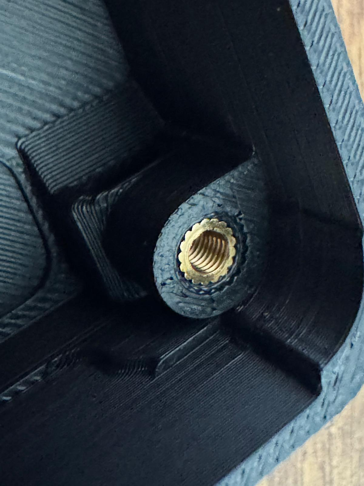
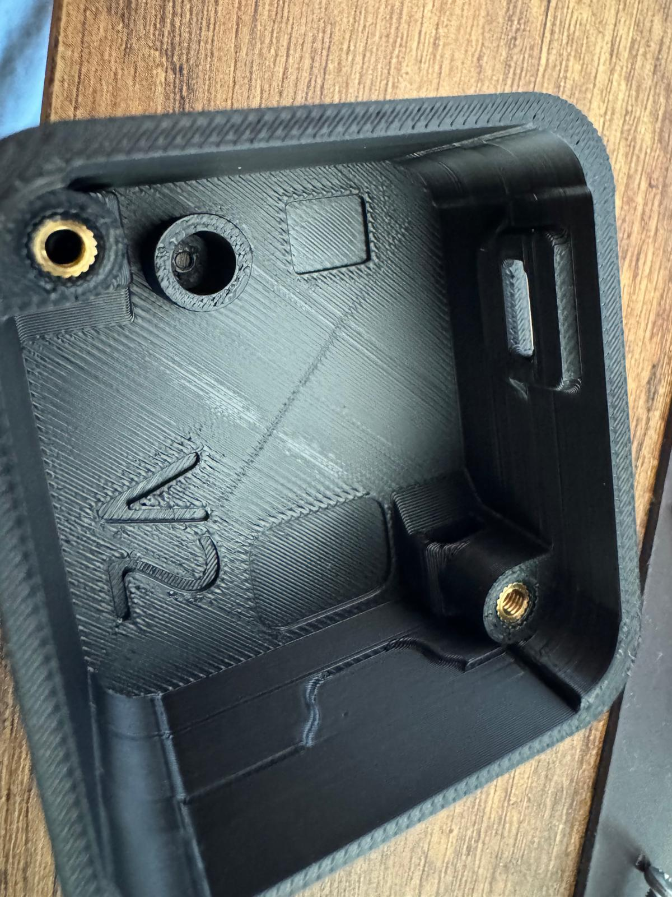

# Printing & assembly

The current design is **v2.1**. Print the three parts in [`../stl/`](../stl/)
with the settings below, then follow
**[GeoShake T1 - Assembly Guide.pdf](GeoShake%20T1%20-%20Assembly%20Guide.pdf)**
for the build sequence.

> **About the guide.** It was drawn for the Rev-C parts and is being redrawn for
> v2.1. Everything it shows about the *sequence* and about the **nut method** is
> still correct — v2.1 supports both fixing methods on purpose. What it does not
> show yet is the **heat-set insert method**; the two photos in this folder cover
> that until the new revision lands.

## Print settings

**ASA is the recommended material.** It is what we print, and it holds up to
heat, sunlight and long unattended runs far better than PETG. PETG still works
for a device that lives indoors and out of direct sun.

| Part | Infill |
|---|---|
| `GS_T1_Enclosure_Top_v2_1` | **15 %** |
| `GS_T1_Enclosure_Base_v2_1` | **99 %** |
| `GS_T1_Mounting_Base_v2_1` | **99 %** |

| | Value |
|---|---|
| Sparse infill pattern | **Gyroid** (all three parts) |
| Supports | Not required — all three print support-free |
| Layer height / walls | Not critical; 0.2 mm and 3 walls works well |

The split is deliberate and it is not a saving. The lid is printed light on
purpose — that is part of how v2.1 gets its Wi-Fi performance, so raising it
gives the gain back. The base and the mounting base go the other way, near
solid, so the sensor is coupled to the structure it is bolted to rather than to
a hollow shell.

## Heat-set inserts

The v2.1 lid seats have a conical lead-in (Ø5.4 mm tapering to the Ø3.6 mm
pilot) that Rev-C did not have. It lets the insert start straight and sit flush
without reaming — this is the change that makes the insert method the one we
recommend.

Standard **M3 heat-set inserts**, installed with a soldering iron at the usual
insert temperature for your filament. Press in slowly, keep the insert
perpendicular, and stop when the shoulder is flush with the boss face.

## Hardware (BOM)

Two fixing methods; pick one. Neither is more correct than the other — the
insert method is what we recommend and what we print for.

### Method A — heat-set inserts (recommended)

| Qty | Item |
|---|---|
| 2 | M3 heat-set insert |
| 2 | M3 × 15 mm screw |

### Method B — nuts (the method the PDF illustrates)

| Qty | Item |
|---|---|
| 2 | M3 heat-set insert |
| 2 | M3 nut |
| 2 | M3 × 15 mm screw |
| 2 | M3 × 25 mm screw |

### Wall or floor fixing (both methods)

| Qty | Item |
|---|---|
| 2 | 4 × 35 mm chipboard screw |
| 2 | 6 mm wall plug, 30 mm |

The mounting base has two Ø4.5 mm fixing holes, 65.5 mm apart, countersunk for
the screw head.

## Mounting

**Screw the mounting base to a wall or to the floor.** This is not optional
finishing — it is the step that decides what your station measures. Coupling
between the device and the structure is the whole point: a station standing
loose on a shelf records the furniture, and a station standing loose on the
floor records itself rocking. Fix the mounting base to a load-bearing wall or a
solid floor, then seat the device firmly in it.

## What is not in the box

Maker Edition ships as the assembled, tested board and nothing else. The
enclosure, the M3 hardware above, the wall fixings, **and the USB-C cable and
power source** are all yours to supply.
